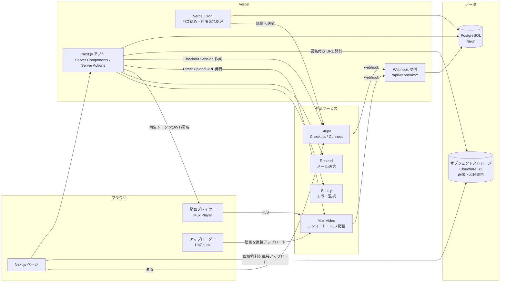
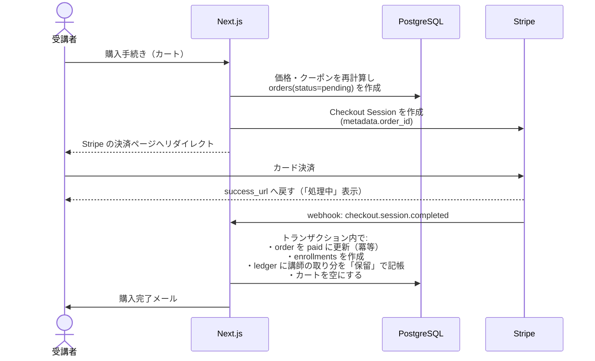
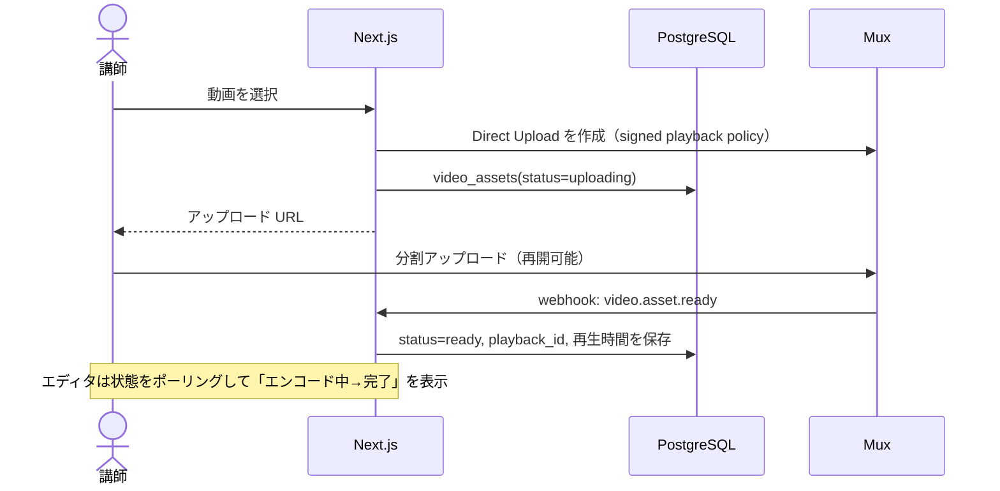
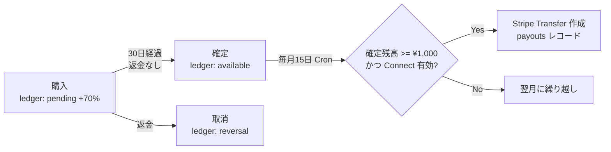

# 2. アーキテクチャ設計

## 2.1 方針

1. **モジュラーモノリス**: Next.js の1アプリに UI・業務ロジック・API をまとめる。内部はドメインごとにモジュールを分け、境界を守る（→ [ADR-0001](./adr/0001-modular-monolith-nextjs.md)）。
2. **難しいところはマネージドサービスに任せる**: 決済（Stripe）、動画のエンコードと配信（Mux）、メール、DB の運用は自分たちで作らない。
3. **お金と権限はサーバーで決める**: 価格・受講資格・手数料の計算はすべてサーバー側。クライアントから届いた値は信用しない。
4. **外部イベントは Webhook を正とする**: 決済完了・動画の準備完了は、リダイレクトではなく Webhook で確定させる。処理は冪等にする。

## 2.2 システム構成



### コンポーネントと選定理由

| 役割 | 採用 | 理由 / 代替案 |
| --- | --- | --- |
| アプリ | **Next.js 15 (App Router)** + TypeScript | MVP の資産を流用できる。SSR で SEO に強い（コース詳細ページは集客の入口）。代替: Remix, Rails |
| ホスティング | **Vercel** | ゼロ運用・プレビュー環境・Cron が揃う。長時間処理が必要になったら一部をワーカーに切り出す |
| DB | **PostgreSQL（Neon）** + **Drizzle ORM** | トランザクションが必要な会計データに適する。日本語の部分一致検索は `pg_trgm` で対応（→ [ADR-0002](./adr/0002-postgresql-drizzle.md)） |
| 決済 | **Stripe Checkout + Connect** | カード情報を持たずに済む。講師への送金と本人確認を Connect に任せられる（→ [ADR-0003](./adr/0003-stripe-connect-payments.md)） |
| 動画 | **Mux Video** | 直接アップロード・自動エンコード・署名付き再生・プレイヤーが揃っている。代替: Cloudflare Stream（→ [ADR-0004](./adr/0004-mux-video.md)） |
| ファイル | **Cloudflare R2**（S3 互換） | 外向き転送料金がかからない。サムネイル・添付資料・修了証 PDF を保存 |
| 認証 | **Auth.js（NextAuth v5）** + DB セッション | メール+パスワード / Google に対応。セッションは DB に保存して即時失効できるようにする |
| メール | **Resend** + React Email | テンプレートを React で書ける |
| 監視 | **Sentry** + Vercel Analytics + 外形監視 | |
| 検索 | PostgreSQL（`pg_trgm`） | 数百コース程度なら十分。数千コースを超えたら Meilisearch などを検討 |

> 規模が10倍になっても、Neon のスケールアップと Vercel の自動スケールで対応する。構成の変更は想定しない。

## 2.3 アプリ内のモジュール構成

```
src/
  app/                      # ルーティングと画面（薄く保つ）
    (public)/               # トップ、検索、コース詳細、講師プロフィール
    (learner)/              # マイラーニング、学習プレイヤー、カート
    instructor/             # 講師ダッシュボード、コースエディタ
    admin/                  # 管理画面
    api/webhooks/{stripe,mux}/route.ts
    api/cron/{settle,cleanup}/route.ts
  modules/                  # ドメインロジック（画面から独立）
    identity/               # ユーザー、セッション、権限
    catalog/                # コース、カリキュラム、検索、審査
    media/                  # 動画アセット、ファイルアップロード
    commerce/               # カート、注文、クーポン、返金
    ledger/                 # 講師残高の台帳、月次締め、送金
    learning/               # 受講登録、進捗、修了証
    community/              # レビュー、Q&A、お知らせ、通報
    notification/           # メール、サイト内通知
  lib/                      # DB クライアント、外部 SDK のラッパー、共通ユーティリティ
```

**ルール**

- `app/` から呼んでよいのは `modules/*` の公開関数（各モジュールの `index.ts`）だけ。
- モジュール間の依存は一方向: `commerce → catalog`、`learning → commerce`、`ledger → commerce`。循環させない。
- 権限チェックは各モジュールの公開関数の入口で行う（`assertCanEditCourse(user, courseId)` など）。画面側のチェックは表示制御だけに使う。

## 2.4 主要なフロー

### 2.4.1 購入



- 注文作成時に**金額を確定して保存**する（その後の値下げや手数料率の変更は既存の注文に影響しない）。
- `stripe_event_id` を一意キーとして保存し、同じイベントの二重処理を防ぐ。
- success_url では受講を確定させない。Webhook の反映を待つ（数秒間ポーリングで確認する）。

### 2.4.2 動画アップロード



### 2.4.3 動画再生の認可

1. プレイヤーページの Server Component で `canWatch(user, lecture)` を判定する（受講者 / 講師本人 / 無料プレビュー / 管理者）。
2. 許可されたら、Mux の署名鍵で**有効期限つきの再生トークン（JWT、例: 6時間）**をサーバーで発行し、プレイヤーに渡す。
3. 返金や停止で権限がなくなった後は、新しいトークンが発行されない。

### 2.4.4 講師への支払い（月次締め）



- 講師の残高は**台帳（ledger_entries）の合計**で求める。残高カラムを直接書き換えない。
- 送金処理は `payout_id` 単位で冪等にする（Stripe の Idempotency-Key を使う）。

## 2.5 横断的な関心事

| 項目 | 方針 |
| --- | --- |
| 認可 | ロール（learner / instructor / admin）＋リソースの所有者チェック。`modules/identity/policy.ts` に集約する |
| 入力検証 | Zod スキーマを Server Action・Route Handler の入口で必ず通す |
| CSRF | Server Actions は Next.js の Origin チェックを使う。Webhook は署名を検証する |
| レート制限 | ログイン・登録・パスワードリセット・レビュー投稿（Upstash Redis もしくは DB で実装） |
| ファイル | アップロードは署名付き URL で直接送る。MIME タイプとサイズを制限。資料のダウンロードは期限つき署名 URL |
| 金額 | 整数（円）で扱う。税額・手数料の端数処理（切り捨て等）のルールを `modules/commerce/pricing.ts` の1か所に集約する |
| 時刻 | DB は `timestamptz`（UTC）。表示は Asia/Tokyo |
| 監査 | 管理者の操作、価格変更、返金、送金を `audit_logs` に記録する |
| キャッシュ | カタログのページは `revalidateTag` で更新時に無効化する。個人別のページはキャッシュしない |
| 非同期処理 | 初期は Webhook と Cron で足りる。メールの一斉送信などが重くなったら Inngest などのジョブ基盤を追加する |

## 2.6 環境

| 環境 | 用途 | 構成 |
| --- | --- | --- |
| local | 開発 | Docker の Postgres、Stripe CLI で Webhook を転送、Mux はテスト環境 |
| preview | PR ごとの確認 | Vercel Preview ＋ Neon のブランチ DB、Stripe テストモード |
| production | 本番 | Vercel ＋ Neon（PITR 有効）、Stripe 本番、Mux 本番 |

CI（GitHub Actions）: 型チェック → Lint → ユニットテスト → DB マイグレーションの検証 → Playwright の E2E（Preview 環境に対して）。
