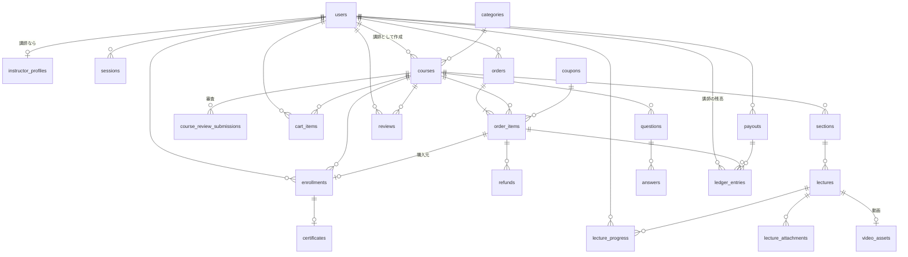
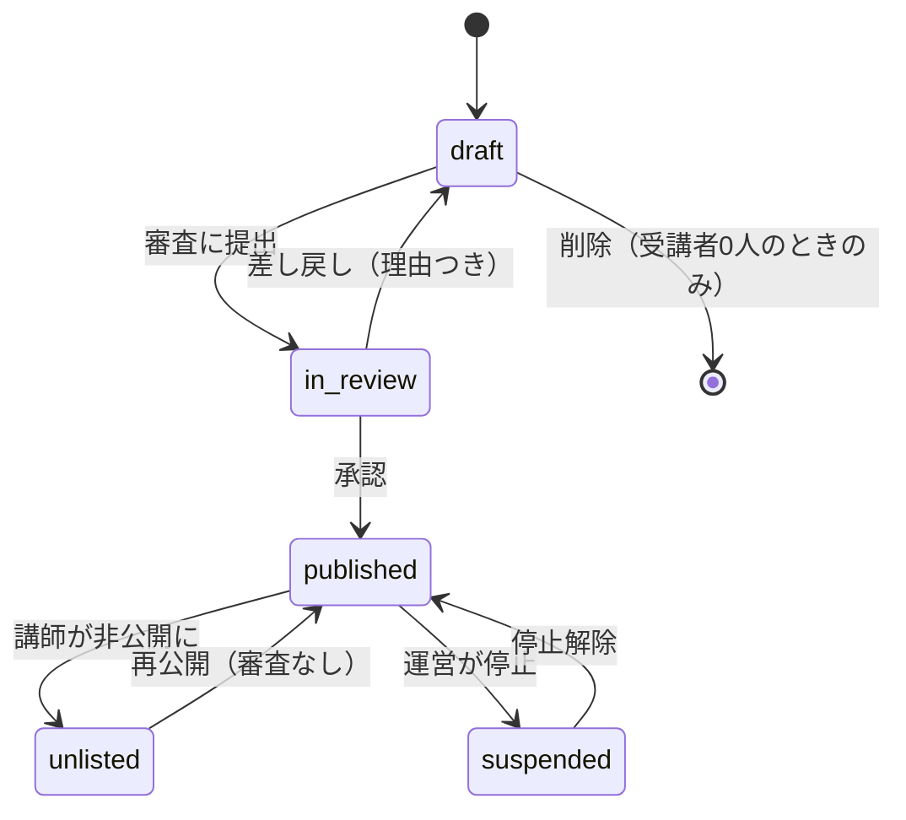

# 3. データモデル

PostgreSQL を前提とする。共通ルール:

- 主キーは `bigint generated always as identity`。外部に出す ID（URL・Stripe の metadata）は推測されにくい `public_id`（UUIDv7）を使う。
- 時刻は `timestamptz`。全テーブルに `created_at`、更新されるテーブルには `updated_at` を持たせる。
- 金額は `integer`（円）。
- 会計系のテーブル（orders / order_items / refunds / ledger_entries / payouts）は**更新・削除をしない**。訂正は新しいレコードを追加して行う。

## 3.1 ER 図

## 3.2 テーブル定義

### identity

**users**

| カラム | 型 | 説明 |
| --- | --- | --- |
| id | bigint PK | |
| public_id | uuid UNIQUE | |
| email | citext UNIQUE | |
| email_verified_at | timestamptz NULL | |
| password_hash | text NULL | OAuth のみのユーザーは NULL |
| name | text | |
| avatar_url | text NULL | |
| headline / bio | text | |
| roles | text[] | `{learner}`、`{learner,instructor}`、`{learner,admin}` など |
| status | text | `active` / `suspended` / `deleted` |
| deleted_at | timestamptz NULL | 退会時に個人情報を匿名化した日時 |

**accounts**（OAuth 連携。Auth.js の標準スキーマ）、**sessions**（`token_hash`、`user_id`、`expires_at`）、**verification_tokens**（メール確認・パスワードリセット）

**instructor_profiles**

| カラム | 型 | 説明 |
| --- | --- | --- |
| user_id | bigint PK FK | |
| stripe_account_id | text NULL UNIQUE | Connect のアカウント |
| payouts_enabled | boolean | `account.updated` webhook で更新 |
| invoice_registration_number | text NULL | 適格請求書発行事業者の登録番号（[Q2](./01-requirements.md#17-未決事項)） |
| revenue_share_bps | integer NULL | 講師個別の分配率（基準点 = 1/100%。NULL ならデフォルト 7000） |
| agreed_terms_version | text | 同意した講師規約のバージョン |

### catalog

**categories**: `id`, `slug`, `name`, `parent_id`（2階層まで）, `position`

**courses**

| カラム | 型 | 説明 |
| --- | --- | --- |
| id / public_id | | |
| instructor_id | bigint FK users | |
| slug | text UNIQUE | URL 用 |
| title / subtitle / description | text | |
| what_you_learn / requirements | text[] | |
| category_id | FK | |
| level | text | `beginner` / `intermediate` / `advanced` / `all` |
| price | integer | 税込の円。0 なら無料 |
| thumbnail_key | text NULL | R2 のキー |
| promo_video_asset_id | FK NULL | |
| status | text | 下の状態遷移を参照 |
| published_at | timestamptz NULL | |
| search_text | text | タイトル・サブタイトル・講師名の結合（講師名は別テーブルのため生成列にできず、更新時にアプリで書き込む）。`pg_trgm` の GIN インデックスを張る |
| *集計キャッシュ* | | `rating_avg`、`rating_count`、`enrollment_count`、`total_duration_sec`、`lecture_count`。書き込み時に更新し、一覧ページを高速にする |

コースの状態遷移:

`unlisted` / `suspended` のコースも、購入済みの受講者は視聴できる（`suspended` で視聴も止めるかは運営が判断）。

**course_review_submissions**（審査履歴）: `course_id`, `submitted_at`, `reviewer_id`, `decision`（`approved` / `rejected`）, `comment`, `decided_at`

**sections**: `id`, `course_id`, `title`, `position`

**lectures**

| カラム | 型 | 説明 |
| --- | --- | --- |
| id / public_id | | |
| section_id | FK | |
| title | text | |
| kind | text | `video` / `article` |
| video_asset_id | FK NULL | |
| body | text | 記事、またはレクチャーノート（Markdown） |
| duration_sec | integer | 動画は Mux から取得、記事は講師が入力 |
| is_free_preview | boolean | |
| position | integer | |

位置（position）は同じ親の中で `UNIQUE (section_id, position) DEFERRABLE` にして、並び替えをトランザクションでまとめて行う。

### media

**video_assets**

| カラム | 型 | 説明 |
| --- | --- | --- |
| id | | |
| owner_id | FK users | |
| mux_upload_id / mux_asset_id | text UNIQUE | |
| mux_playback_id | text NULL | signed ポリシー |
| status | text | `uploading` / `processing` / `ready` / `errored` |
| duration_sec | integer NULL | |
| original_filename | text | |

**lecture_attachments**: `lecture_id`, `file_key`（R2）, `filename`, `size_bytes`, `content_type`

### commerce

**cart_items**: `(user_id, course_id)` PK

**coupons**

| カラム | 型 | 説明 |
| --- | --- | --- |
| code | text | `UNIQUE (issuer_scope, code)` |
| issuer_type | text | `platform` / `instructor` |
| course_id | FK NULL | 講師クーポンは対象コースが必須 |
| discount_type / discount_value | text / integer | `percent`（1〜100）/ `fixed`（円） |
| starts_at / ends_at | timestamptz | |
| max_redemptions / redeemed_count | integer | |

**orders**

| カラム | 型 | 説明 |
| --- | --- | --- |
| id / public_id | | |
| user_id | FK | |
| status | text | `pending` / `paid` / `canceled` / `expired` |
| subtotal / discount_total / total | integer | 確定した金額 |
| tax_total | integer | 消費税額（総額から内税として計算） |
| stripe_checkout_session_id | text UNIQUE | |
| stripe_payment_intent_id | text UNIQUE NULL | |
| paid_at | timestamptz NULL | |

**order_items**

| カラム | 型 | 説明 |
| --- | --- | --- |
| id | | |
| order_id / course_id | FK | |
| instructor_id | FK | 購入時点の講師 |
| list_price / discount / price_paid | integer | |
| coupon_id | FK NULL | |
| revenue_share_bps | integer | 購入時点の分配率（スナップショット） |
| instructor_amount / platform_amount | integer | 端数はプラットフォーム側に寄せる |
| refunded_amount | integer | |

**refunds**: `order_item_id`, `amount`, `reason`, `status`（`requested` / `succeeded` / `failed`）, `stripe_refund_id`, `requested_by`, `processed_by`

**processed_webhook_events**: `(provider, event_id)` PK, `processed_at` — Webhook の冪等性を保証する

### ledger（講師への支払い）

**ledger_entries**

| カラム | 型 | 説明 |
| --- | --- | --- |
| id | | |
| instructor_id | FK | |
| type | text | `sale` / `refund_reversal` / `payout` / `adjustment` |
| amount | integer | 正 = 講師の残高が増える、負 = 減る |
| order_item_id | FK NULL | |
| payout_id | FK NULL | |
| available_at | timestamptz | `sale` は購入から30日後。それ以外は作成時刻 |
| memo | text | |

- **確定残高** = `available_at <= now()` のエントリの合計（payout 分はマイナスで記帳済み）。
- **保留中** = `available_at > now()` のエントリの合計。

**payouts**: `instructor_id`, `amount`, `period_end`, `status`（`pending` / `paid` / `failed`）, `stripe_transfer_id`, `idempotency_key`

### learning

**enrollments**

| カラム | 型 | 説明 |
| --- | --- | --- |
| (user_id, course_id) | PK | |
| source | text | `purchase` / `free` / `admin_grant` |
| order_item_id | FK NULL | |
| status | text | `active` / `revoked`（返金時） |
| last_lecture_id | FK NULL | 「続きから再生」用 |
| completed_at | timestamptz NULL | |

**lecture_progress**: `(user_id, lecture_id)` PK, `position_sec`, `completed_at NULL`, `updated_at`

- 再生位置はクライアントから15秒ごと＋ページを離れるときに送る。
- 動画の90%以上を視聴するか、ボタンを押したら完了とする。

**certificates**: `public_id`（検証 URL に使う）, `user_id`, `course_id`, `issued_at`, `name_snapshot`, `course_title_snapshot`

### community

**reviews**: `UNIQUE (user_id, course_id)`, `rating`（1〜5）, `body`, `status`（`visible` / `hidden`）, `instructor_reply`

**questions**: `course_id`, `lecture_id NULL`, `user_id`, `title`, `body`, `status`

**answers**: `question_id`, `user_id`, `body`, `is_instructor`

**announcements**: `course_id`, `title`, `body`, `sent_at`

**reports**: `target_type`（`course` / `review` / `question` / `answer`）, `target_id`, `reporter_id`, `reason`, `status`, `resolved_by`

### 運用

**notifications**: `user_id`, `type`, `payload jsonb`, `read_at`

**audit_logs**: `actor_id`, `action`, `target_type`, `target_id`, `before jsonb`, `after jsonb`, `ip`, `created_at`

**settings**: `key`, `value jsonb`（デフォルトの分配率、返金期間など）

## 3.3 主なインデックス

| テーブル | インデックス | 用途 |
| --- | --- | --- |
| courses | `(status, category_id, enrollment_count DESC)` | カテゴリ別の人気順 |
| courses | GIN `search_text gin_trgm_ops` | 日本語の部分一致検索 |
| lectures | `(section_id, position)` | カリキュラム表示 |
| enrollments | `(user_id, created_at DESC)` | マイラーニング |
| lecture_progress | `(user_id, lecture_id)` PK | 進捗 |
| reviews | `(course_id, created_at DESC) WHERE status='visible'` | レビュー一覧 |
| ledger_entries | `(instructor_id, available_at)` | 残高計算 |
| orders | `(user_id, created_at DESC)` | 購入履歴 |

## 3.4 MVP からの移行

| MVP（SQLite） | 本設計 | 変更点 |
| --- | --- | --- |
| `users.role` | `users.roles[]` + `instructor_profiles` | 管理者ロールを追加、Connect の情報 |
| `courses.published` | `courses.status` | 審査フローを追加 |
| `lectures.video_url` | `video_assets` | 外部 URL から Mux の管理に移行 |
| `enrollments.price_paid` | `orders` / `order_items` / `ledger_entries` | 会計を正しく記録 |
| `lecture_progress` | `+ position_sec` | 再生位置の保存 |
| `cart_items`、`reviews` | ほぼそのまま | |

本番ユーザーのデータは無いので、データの移行は行わずにスキーマを作り直す。
