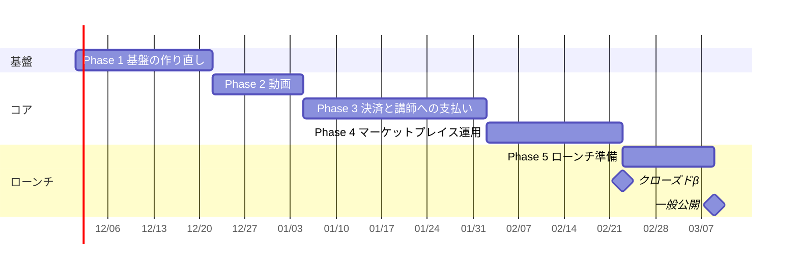

# 5. 開発ロードマップ

1〜2名での開発を想定した目安。各フェーズの終わりに、動く状態でデプロイする。

合計で約14週間（3.5か月）。並行して、[未決事項](./01-requirements.md#17-未決事項)（特に Q1・Q2 の税務・法務）を **Phase 3 開始まで**に決める。

## Phase 0: プロトタイプ ✅ 完了

`src/` の MVP。画面構成と業務フロー（検索 → 購入 → 受講 → レビュー、講師のコース作成）を確認できる状態。

## Phase 1: 基盤の作り直し（3週間）

目的: 本番に耐える土台を作る。機能は増やさない。

- [ ] `src/modules/*` 構成へのリファクタリング（[2.3](./02-architecture.md#23-アプリ内のモジュール構成)）
- [ ] PostgreSQL（Neon）+ Drizzle、マイグレーション、シードスクリプト
- [ ] Auth.js: メール確認、パスワードリセット、Google ログイン、レート制限
- [ ] ロールと認可ポリシー（`admin` の追加）
- [ ] 入力検証を Zod に統一
- [ ] CI（型チェック・Lint・ユニットテスト・Playwright）、Vercel の Preview 環境
- [ ] Sentry、構造化ログ

**完了条件**: MVP と同じ機能が Postgres 上で動き、E2E テストが CI で通る。

## Phase 2: 動画（2週間）

- [ ] Mux Direct Upload（講師のエディタから、再開可能なアップロード）
- [ ] Mux Webhook → `video_assets` の状態更新、エンコード状況の表示
- [ ] 署名付き再生（JWT）と Mux Player の組み込み
- [ ] 再生位置の保存、「続きから再生」、90%視聴で自動完了
- [ ] R2 への画像・添付資料のアップロード

**完了条件**: 講師が動画をアップロードし、受講者だけが再生できる。URL を共有しても期限が切れると再生できない。

## Phase 3: 決済と講師への支払い（4週間）← 最も重要

- [ ] `orders` / `order_items` / `ledger_entries` / `payouts` のスキーマ
- [ ] Stripe Checkout（カート一括購入）、Webhook の冪等処理
- [ ] 購入完了画面のポーリング、購入完了メール・領収書
- [ ] Stripe Connect のオンボーディング（講師の本人確認・口座登録）
- [ ] 返金（自動の条件判定 + 管理者による承認）、台帳の取り消し
- [ ] 月次の送金 Cron、照合（reconcile）Cron
- [ ] 講師の売上・入金履歴画面
- [ ] 金額計算（分配・端数・税）のユニットテストを網羅

**完了条件**: Stripe のテストモードで「購入 → 返金 → 締め → 送金」を一通り実行し、台帳の合計と Stripe の残高が一致する。

## Phase 4: マーケットプレイス運用（3週間）

- [ ] コース審査フロー（提出 → 承認/差し戻し）と講師への通知
- [ ] 管理画面: 審査キュー、ユーザー・注文の検索、返金、通報、監査ログ
- [ ] Q&A、講師からのお知らせ、レビューへの返信
- [ ] トランザクションメール一式（React Email）
- [ ] 修了証（検証 URL つき）

**完了条件**: 運営スタッフが管理画面だけで日常業務を回せる。→ **クローズドβ**（招待した講師5〜10名と受講者）

## Phase 5: ローンチ準備（2週間）

- [ ] 利用規約（受講者・講師）、プライバシーポリシー、特定商取引法に基づく表記
- [ ] SEO（メタデータ、構造化データ `Course`、サイトマップ、OGP 画像）
- [ ] セキュリティレビュー（認可の抜け、IDOR、Webhook、ファイルアップロード）
- [ ] 負荷テスト（同時200視聴、検索）、バックアップの復元テスト
- [ ] アクセシビリティの確認、監視とアラート、障害対応手順書
- [ ] Stripe・Mux を本番モードに切り替え

**完了条件**: 一般公開。

## ローンチ後（優先度順の候補）

1. クーポン・セール価格（講師の集客手段として要望が出やすい）
2. ウィッシュリスト、講師の公開プロフィール
3. 講師向けの分析（完了率、離脱レクチャー）
4. サイト内通知、メール配信設定
5. クイズ・課題
6. 字幕の自動生成
7. 検索エンジンの導入（コース数が数千を超えたら）
8. 法人向けプラン（B2B）

## リスク

| リスク | 影響 | 対策 |
| --- | --- | --- |
| 税務・法務（販売主体、インボイス）が決まらない | Phase 3 の設計が変わる | Phase 1 の間に専門家に相談し、Phase 3 開始までに決定 |
| Stripe Connect の日本での利用条件・審査 | 講師への送金ができない | Phase 1 で Stripe に事前確認。アカウントの種類（Express / Custom）も確認 |
| 動画の配信コストが想定を超える | 赤字 | Mux の使用量アラート。解像度の上限設定。Cloudflare Stream への移行を [ADR-0004](./adr/0004-mux-video.md) で想定済み |
| 動画の違法アップロード・著作権侵害 | 法的リスク | 審査フロー、通報、規約、削除依頼の窓口 |
| 少人数での運用負荷 | 開発が止まる | マネージドサービスの利用、管理画面での自己解決、監視の自動化 |
